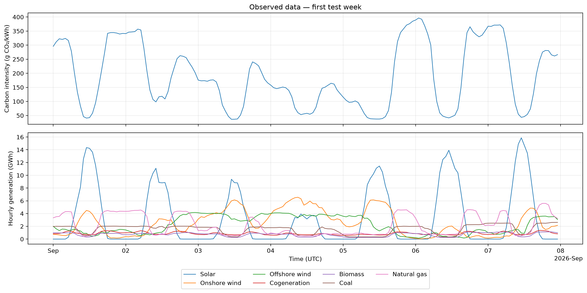
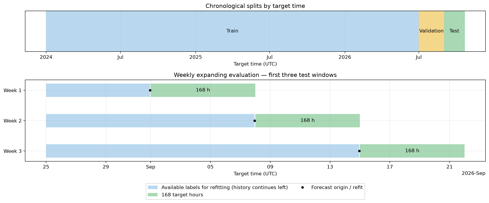
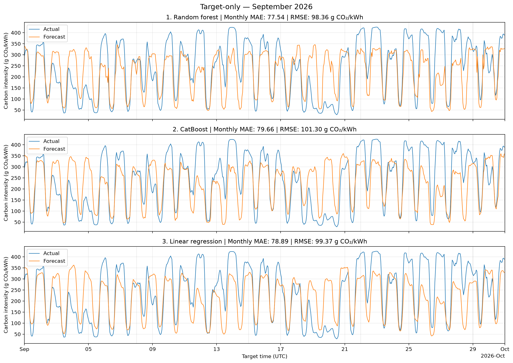
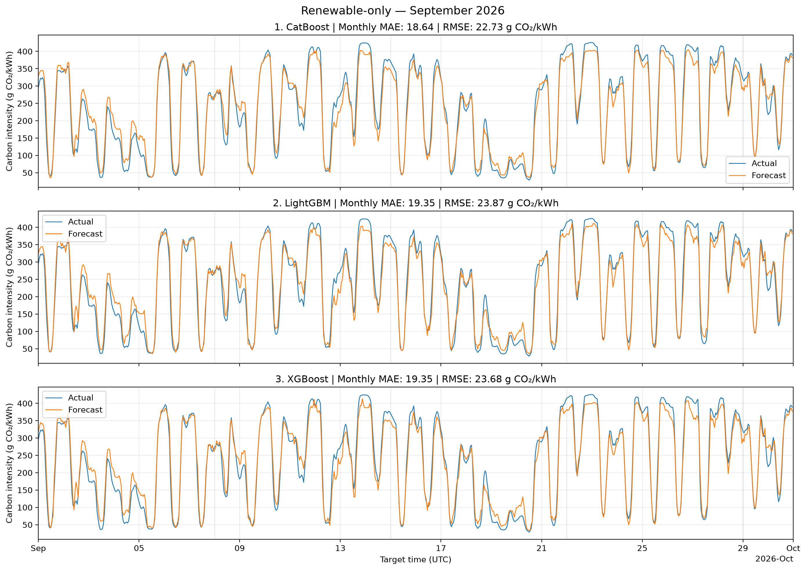
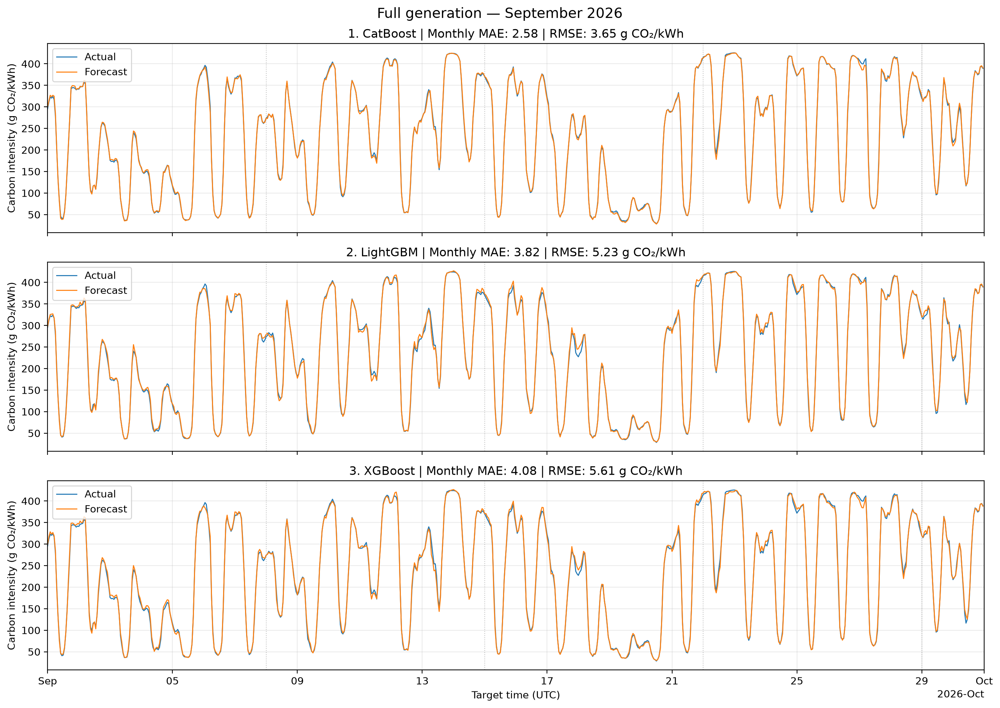

# Forecasting the Carbon Intensity of Electricity Generation in the Netherlands

## 1. Problem Statement

The objective is to forecast the carbon intensity of electricity generation in the Netherlands for the next seven days at hourly resolution: 168 values following the forecast origin. The target variable is the NED-published CO₂ emission factor per unit of electricity generated. In this report, intensity and errors are expressed in g CO₂/kWh.

Three scenarios with different available information are compared:

| Scenario | Input data |
|---|---|
| Target-only | Target history and calendar features; target history alone for SMA |
| Renewable-only | Solar, onshore and offshore wind generation, biomass, and calendar features |
| Full generation | All renewable-only features, plus coal, natural gas, and cogeneration |

“Full generation” refers to the complete set of seven sources in the modeling dataset; nuclear and waste generation are not included.

The target-only scenario demonstrates how a model can forecast intensity without knowing future generation. This brings the experiment closer to practical conditions: actual future generation volumes are unknown at the forecast origin, and reliable seven-day forecasts for all required sources may be unavailable. In this situation, a model can rely on intensity history and calendar features known in advance. This scenario assesses the accuracy achievable without external generation forecasts.

**Main assumption:** in the generation scenarios, future actual generation values are used instead of forecasts. Performance is therefore measured under perfect knowledge of future inputs. These results do not yet assess operational forecasting accuracy with real generation forecast errors. Target-only uses only available target history and the calendar known in advance.

## 2. Data and Preparation

### 2.1. Source and Features

Historical hourly exports from the Nederlandse Energie Data (NED) portal were used, as specified in the [assignment](../../docs/initial_assignment.md). Joining the data by UTC time produced 24,575 observations, from December 31, 2023, at 23:00 to October 20, 2026, at 21:00. The time grid has a one-hour interval. Generation is represented as hourly energy in kWh; the target is stored in kg CO₂/kWh and converted to grams when calculating metrics and plotting figures.

Generation forecasts were unavailable for the experiments, so actual historical generation values were used as inputs. During weekly forecast evaluation, these values are supplied for future hours, corresponding to the assumption of perfect generation forecasts. The reported metrics do not account for real generation forecast errors.

For generation models, features and the target refer to the same hour. Calendar features—weekend and holiday indicators for the Netherlands—are calculated for the predicted hour in the Europe/Amsterdam time zone. The calendar includes public and optional holidays, including Liberation Day every year.

Target-only regression models use the intensity at the feature row's time and lags of 1, 2, 3, 24, 48, 168, 336, and 504 hours. Calendar features refer to the predicted hour. The seasonal moving average provides a simple performance baseline and uses only intensity history.

The choice of lags is motivated by exploratory analysis: intensity is highly correlated between adjacent hours and exhibits daily and weekly recurrence. Lags of 1–3 hours describe recent dynamics, 24 and 48 hours capture daily recurrence, and 168, 336, and 504 hours provide the history of the same hour of the week. Data completeness and export quality were considered when selecting sources: `other` is missing 2,605 hours, waste generation contains long stretches of almost constant values, and nuclear generation has missing hours and a suspicious boundary observation. These sources are excluded from the current set; their additional predictive value was not evaluated separately.

Three rows of processed data are shown below. Only a subset of features is displayed for compactness; generation volumes are converted to GWh.

| UTC time | Intensity, g CO₂/kWh | Solar, GWh | Onshore wind, GWh | Offshore wind, GWh |
|---|---:|---:|---:|---:|
| 2026-09-01 00:00:00 | 295.79 | 0.000 | 0.761 | 2.006 |
| 2026-09-01 01:00:00 | 311.84 | 0.000 | 0.711 | 1.602 |
| 2026-09-01 02:00:00 | 322.54 | 0.000 | 0.656 | 1.332 |

*Figure 1. Example of processed observations for September 1–7, 2026: carbon intensity above and seven generation sources below. The shared time axis allows changes in generation and intensity to be compared; these are observations, not forecasts.*

### 2.2. Missing Values and Corrections

The target has no missing values. Among the seven selected sources, offshore wind generation is missing 25 hours and cogeneration is missing 26 hours. Offshore wind gaps are filled with the value from the same hour of the previous day; for gaps longer than a day, the profile is repeated sequentially. Cogeneration gaps are filled with the mean of values 168 and 336 hours before the missing observation. Both rules use only preceding history.

Repeating the daily wind profile was chosen as a simple heuristic that preserves the complete hourly grid. Weekly offsets for cogeneration match the same hours and days of the week, while averaging two values reduces dependence on a single historical observation. These rules do not guarantee recovery of actual generation; the sensitivity of the final metrics to the imputation method was not assessed separately.

In addition, suspicious onshore and offshore wind values at the export boundary, October 20, 2026, at 21:00 UTC, were replaced with the previous hourly value. This observation falls outside the complete test weeks evaluated. In total, at least one feature was corrected in 27 rows; correction flags are retained for quality control but are not used as model inputs. After processing, the generation features contain no missing values.

For target-only, initial rows with insufficient lag history and rows without a known future target are excluded from training and evaluation rather than filled with artificial values.

## 3. Models and Evaluation Methodology

### 3.1. Algorithms and Parameter Selection

The comparison includes linear regression, random forest, and three gradient boosting implementations: CatBoost, LightGBM, and XGBoost. The linear model provides a simple baseline for the relationship between the target and the features; tree ensembles can capture nonlinear relationships and interactions between sources. A seasonal moving average is also evaluated for target-only.

Hyperparameters are selected separately for each model and scenario by the lowest validation MAE. For full generation, four linear model configurations, six random forest configurations, and twelve configurations of each boosting model were evaluated. Renewable-only uses a smaller search: two linear model configurations, two random forest configurations, and four configurations of each boosting model. Target-only includes 14 SMA configurations, four linear model configurations, 29 random forest configurations, 66 CatBoost configurations, and 13 configurations each for LightGBM and XGBoost. The searches compare, among other settings, tree depth, tree count, and squared-error versus absolute-error loss. Search budgets differ, so the scenario comparison is not a controlled assessment of individual sources' contributions.

Only one selected configuration per model is run on the test set. The SMA with the best validation score uses a daily period of 24 hours and averages 14 historical values. In both generation scenarios, the selected CatBoost uses 600 trees of depth 6, a learning rate of 0.05, and absolute-error loss.

### 3.2. Temporal Split and Weekly Forecasts

The data are split chronologically by target time:

| Split | UTC period | Purpose |
|---|---|---|
| Train | Before July 1, 2026 | Initial training history |
| Validation | July 1–August 31, 2026 | Hyperparameter selection |
| Test | From September 1 to the end of observations | Final evaluation of selected configurations |

Weekly forecasts are evaluated sequentially with an expanding training history. At each forecast origin T, the model is refitted on all complete rows whose target values are already known by T, then predicts hours T+1 through T+168. The next forecast is issued 168 hours later. Observations from earlier validation or test weeks can enter subsequent training once they become available. Hyperparameters remain fixed; at the start of the test period, all available training and validation history is used.

For target-only, a feature row at time t is paired with the target 168 hours later: y(t) = intensity(t+168). Consequently, a block of 168 historical rows from T−167 to T produces a forecast for T+1…T+168. Training is restricted to rows with t+168 ≤ T. Neither future intensity nor feeding predictions back into the model is needed to construct the weekly forecast.

*Figure 2. Chronological data split and the first three test windows. Blue segments show labels available for refitting; green segments show the next 168 forecast hours. Training history extends to the left beyond the lower panel.*

Only complete 168-hour windows are evaluated. Validation covers eight weeks and 1,344 predictions, from July 1 through August 25 inclusive. All models are evaluated on the same seven test weeks and 1,176 hours, from September 1 through October 19, 2026, inclusive. The remaining incomplete tail of observations is excluded from the metrics.

### 3.3. Metrics

The primary metric is MAE, mean absolute error in g CO₂/kWh, which determines hyperparameter selection. RMSE, root mean squared error, gives greater weight to large deviations. The dimensionless coefficient R² is also reported. Overall metrics are calculated across all included hourly predictions rather than by averaging weekly metrics.

## 4. Results and Conclusions

Results are presented separately for the three scenarios. The tables report metrics for all selected configurations on the same 1,176 test hours. Models are ordered by test MAE; lower MAE and RMSE indicate smaller errors.

In each group, the figure shows the three models with the lowest MAE **on the entire test set**. This is a descriptive selection of illustrations after evaluation; model parameters were selected earlier on validation. All panels cover September 1–30, 2026, and use identical axis limits. Titles report MAE and RMSE only for the 720 hours shown, so they differ from the table metrics. Dashed lines mark the boundaries of successive weekly forecasts: the figures do not represent a month-long forecast from a single origin.

### 4.1. Target-only

| Model | MAE, g CO₂/kWh | RMSE, g CO₂/kWh | R² |
|---|---:|---:|---:|
| Random forest | 76.71 | 96.37 | 0.3852 |
| CatBoost | 79.78 | 103.11 | 0.2962 |
| Linear regression | 79.92 | 102.81 | 0.3002 |
| Seasonal moving average (SMA) | 80.87 | 102.48 | 0.3048 |
| XGBoost | 82.56 | 105.29 | 0.2661 |
| LightGBM | 82.91 | 106.17 | 0.2537 |

Random forest achieves the lowest test MAE at 76.71 g CO₂/kWh. Its result is only moderately better than the seasonal moving average, with an MAE of 80.87. CatBoost and linear regression perform similarly, with MAE around 79.8–79.9; greater model complexity does not provide a large advantage over the seasonal baseline.

However, SMA was the validation winner, with an MAE of 47.26 versus 54.07 for random forest. The increase in test error and the change in model ranking show limited stability across the selected periods. The cause of this deterioration requires further investigation; these experiments cannot conclusively attribute it to distribution shifts or seasonality.

*Figure 3. Target-only: random forest, CatBoost, and linear regression. The models reproduce some regular fluctuations but deviate substantially from actual values in some intervals, including periods of low intensity.*

This scenario demonstrates that a complete weekly forecast can be constructed without knowing future generation. However, during the selected test period, intensity history and calendar features provide substantially lower accuracy than scenarios with known future generation volumes.

### 4.2. Renewable-only

| Model | MAE, g CO₂/kWh | RMSE, g CO₂/kWh | R² |
|---|---:|---:|---:|
| CatBoost | 19.74 | 24.84 | 0.9591 |
| LightGBM | 20.53 | 26.34 | 0.9541 |
| XGBoost | 20.59 | 26.28 | 0.9543 |
| Random forest | 23.48 | 29.15 | 0.9437 |
| Linear regression | 34.16 | 40.98 | 0.8888 |

CatBoost has the lowest test error, with an MAE of 19.74 g CO₂/kWh and an RMSE of 24.84 g CO₂/kWh. It is also the best model on validation in this scenario. LightGBM and XGBoost perform similarly, with MAE around 20.5–20.6; random forest and linear regression are outperformed by all three boosting models.

*Figure 4. Renewable-only: CatBoost, LightGBM, and XGBoost. The models track the main intensity fluctuations, but noticeable deviations from actual values remain in some intervals.*

Under the perfect-input assumption, renewable generation allows substantially lower error than intensity history alone. CatBoost with renewable inputs is the most promising of the evaluated options for the main task, but its practical performance requires evaluation with real generation forecasts.

### 4.3. Full Generation

| Model | MAE, g CO₂/kWh | RMSE, g CO₂/kWh | R² |
|---|---:|---:|---:|
| CatBoost | 2.67 | 3.65 | 0.9991 |
| LightGBM | 3.98 | 5.43 | 0.9981 |
| XGBoost | 4.07 | 5.54 | 0.9980 |
| Random forest | 7.24 | 9.75 | 0.9937 |
| Linear regression | 20.17 | 25.61 | 0.9566 |

CatBoost also achieves the best result here, with an MAE of 2.67 and an RMSE of 3.65 g CO₂/kWh. LightGBM and XGBoost achieve MAE around 4 g CO₂/kWh. As in the renewable-only scenario, all three boosting models outperform random forest and linear regression.

*Figure 5. Full generation: CatBoost, LightGBM, and XGBoost. Actual and predicted values are close when future generation is known; the high accuracy applies specifically to this assumption.*

Additional information on coal, natural gas, and cogeneration is associated with a marked reduction in error relative to the renewable-only scenario. This is consistent with intensity depending on the generation mix. However, the comparison does not isolate each source's contribution, uses different tuning budgets, and does not account for future generation forecast errors.

CatBoost's near-perfect R² ≈ 0.999 should be interpreted in light of this relationship: the model receives realized generation volumes and approximates the relationship between the generation mix and the published intensity for the same hour. This explains why the inputs are highly informative but does not establish comparable weekly forecasting accuracy with real generation forecast errors.

### 4.4. Overall Conclusions

In these experiments, available generation information has a greater effect on performance than the choice among the three boosting implementations. The lowest test MAE is 76.71 g CO₂/kWh for target-only, 19.74 for renewable-only, and 2.67 for full generation. This compares the best observed results rather than estimating the causal contribution of individual features.

CatBoost performs best on both validation and test in the two generation scenarios. In target-only, the validation winner does not retain its lead on test, and the best test model's advantage over the seasonal moving average remains small.

Target-only demonstrates an option that works without external generation forecasts. The other two scenarios show performance under perfect knowledge of future inputs; applying these results to practical forecasting requires a separate evaluation with data actually available at the forecast origin.

Thus, models producing 168 hourly values for the following week have been implemented and evaluated, but the original task using renewable generation forecasts has been evaluated only partially. Because forecast data were unavailable, future actual values were substituted; evaluation with real generation forecasts available when the intensity forecast is issued remains an uncompleted part of the practical task.

## 5. Next Steps

1. **Establish actual data availability.** Determine which generation sources are available, their publication delays, and the horizons covered by their forecasts. If seven-day forecasts for the full generation set are available, evaluate using those forecast values and only versions available at the intensity forecast origin. This will provide more realistic performance estimates. If the full set is unavailable, evaluate the available subset of sources.

2. **Compare with target-only.** Compare models using actually available generation forecasts with target-only models over identical periods and horizons, using the same refitting rules. Use the results to select an approach for further development, considering both accuracy and dependence on external data.

3. **Develop the best approach further.** Experiment with the data: feature sets, history length, lags, and missing-value treatment. Experiment with models and hyperparameters: compare algorithms, loss functions, and training settings. Select changes on validation and confirm final performance on a separate test period covering different seasons.

4. **Deploy the best model to production with observability.** Automate data retrieval, the issuance of 168-hour forecasts, and retraining. Monitor input data availability, delays, and quality; forecast success and execution time; and MAE and RMSE as actual values arrive. Configure alerts for failures and deteriorating performance, and retain data and model versions for troubleshooting and rollback.
